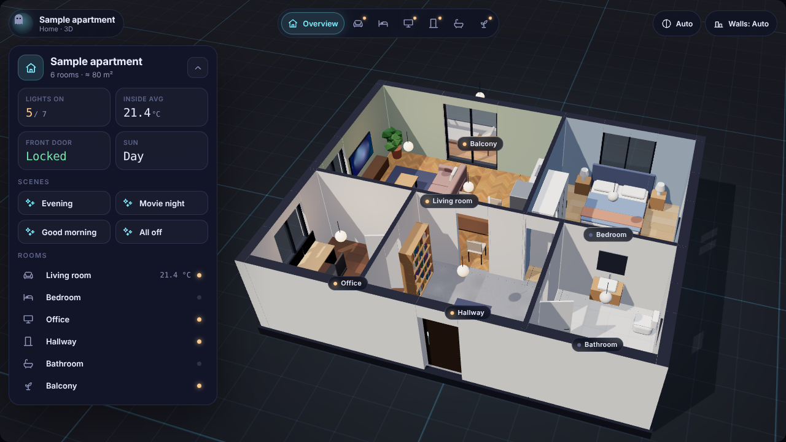

# HomeBoo 3D

Your home as an interactive 3D model in Home Assistant. Tap a room, the camera flies in, and the room's devices appear right next to it. Lights glow inside the model, covers move, the TV shows what is playing and the front door shows whether it is locked.

Draw your own floor plan directly in Home Assistant with drag & drop – no Blender, no Sweet Home 3D, no external files.



## Features

- **3D view of your home** with smooth camera flights into each room, room labels and a room bar
- **Live device states**: lights (brightness and colour), covers, locks, media players, climate, switches and fans
- **Control panel per room** – devices come from the floor plan and from the linked Home Assistant **area**
- **Floor plan editor** built into the card configuration: draw rooms, drag walls and corners, drop doors, windows, furniture and lights
- Walls are generated automatically from the room outlines, including open transitions between rooms
- Trace an image of your floor plan and set the scale with a known distance
- Day and night follow `sun.sun`, scenes are available from the overview
- German and English

## Installation

### HACS (custom repository)

1. Open **HACS** → three-dot menu → **Custom repositories**
2. Add `https://github.com/AbuTvboo/homeboo-3d-card` with type **Dashboard**
3. Search for **HomeBoo 3D** and install it
4. Reload the browser

### Manual

1. Copy `dist/homeboo-3d-card.js` to `/config/www/homeboo-3d-card.js`
2. Add it as a resource: **Settings → Dashboards → ⋮ → Resources** → `/local/homeboo-3d-card.js`, type **JavaScript module**

## Getting started

1. Edit a dashboard and add the card **HomeBoo 3D** (a sample apartment is pre-loaded)
2. Click **Open floor plan editor**
3. Load the sample or start with an empty plan, then draw your rooms
4. Select a room and pick its **Home Assistant area** – all lights, covers, switches and sensors of that area appear in the room
5. Optionally place lights where they really are and link them to an entity, so they glow at the right spot
6. Click **Apply**, then **Save**

For a full-screen view, use a view of type **Panel** and set the height to **Screen height**.

## Configuration

Everything can be set in the visual editor. YAML options:

| Option | Default | Description |
| --- | --- | --- |
| `title` | plan name | Title shown in the top left |
| `height` | `600px` | Card height, any CSS length or `full` |
| `night` | `auto` | `auto` (follows `sun.sun`), `day` or `night` |
| `accent` | `#7ef0ff` | Accent colour |
| `three_url` | jsDelivr CDN | URL of `three.module.js`, for running without internet |
| `plan` | – | The floor plan, written by the editor |

### Running without internet

The 3D engine [three.js](https://threejs.org) is loaded from jsDelivr by default. To keep everything local, download `three.module.js` (version 0.170.0) to `/config/www/homeboo/three.module.js` and set:

```yaml
three_url: /local/homeboo/three.module.js
```

## Floor plan editor

| Action | How |
| --- | --- |
| Draw a room | Tool **Room** and drag a rectangle, or **Free shape** and click the corners |
| Change the shape | Drag corners or the handle in the middle of a wall; **+** adds a corner |
| Open transition | Room properties → set the wall to **Open** |
| Doors, windows, furniture, lights | Drag them from the left bar onto the plan |
| Rotate furniture | Rotation handle or `Q` |
| Undo / redo | `Ctrl+Z` / `Ctrl+Y` |
| Free dragging without snapping | Hold `Shift` |
| Pan | Drag an empty spot or hold `Space` |

The plan is stored in the card configuration and is included in Home Assistant backups. A traced background image stays in your browser only.

## Roadmap

- More floor types, wall colours and furniture
- Multiple floors
- Window and door contact sensors, motion and presence effects
- Bundled build without CDN

## License

MIT

---

## Deutsch – Kurzanleitung

**HomeBoo 3D** zeigt deine Wohnung als 3D-Modell in Home Assistant. Raum antippen, die Kamera fliegt hinein, und die Geräte des Raums erscheinen daneben.

1. In HACS unter **Benutzerdefinierte Repositories** diese Adresse mit Typ **Dashboard** hinzufügen und installieren
2. Dashboard bearbeiten, Karte **HomeBoo 3D** hinzufügen
3. **Grundriss-Editor öffnen**, Räume zeichnen, jedem Raum einen **Bereich** aus Home Assistant zuordnen
4. **Übernehmen** und **Speichern**
